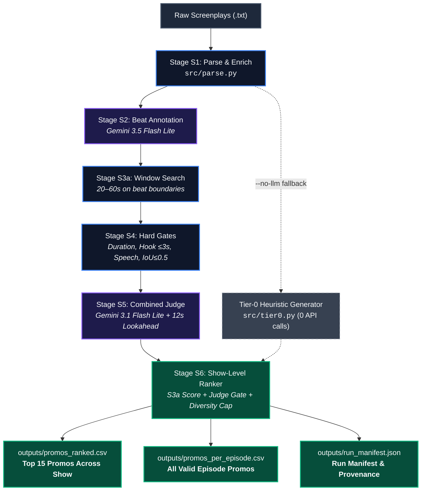

# Promo Finder

Automated microdrama promo clip extraction and ranking system for vertical microdrama screenplays.

Identifies high-conversion promo clip candidates that satisfy four core criteria:
1. **Duration**: 20 to 60 seconds in total duration.
2. **Hook (First 3 Seconds)**: Immediate narrative or visual hook within 3.0s of clip start.
3. **Unresolved Cliffhanger**: Ends abruptly on a high-stakes question, tension spike, or unresolved reveal.
4. **Stand-Alone Clarity**: Understandable and compelling to a cold viewer without prior episode context.

> [!NOTE]
> Cold-viewer stage not built; stand-alone clarity is scored directly by the judge.

---

## Confidentiality & Data Protection

- `data/`, `outputs/`, and `.env` are strictly gitignored at all times.
- Raw screenplay texts, character names, loglines, dialogue snippets, and proprietary extracted candidates are confidential.
- Screenplay dialogue and character identities are never printed to terminal logs, commits, or evaluation reports.

---

## Installation & Setup

### Prerequisites
- Python 3.11+
- Git

### Setup
```bash
git clone <repo-url> promo-finder
cd promo-finder

python -m venv .venv
# Windows (PowerShell)
.\.venv\Scripts\Activate.ps1
# macOS/Linux
source .venv/bin/activate

pip install -r requirements.txt

# Optional: install auxiliary packages (scipy for scripts/run_listwise_strong.py)
pip install -r requirements-extra.txt
```

### Environment Configuration
Create a `.env` file in the repository root:
```env
GEMINI_API_KEY="your-gemini-api-key"
```

---

## Configuration (`config/models.yaml`)

Models are configured by functional role in `config/models.yaml`:

| Role | Default Model | Provider | Responsibility |
|---|---|---|---|
| `cheap` | `gemini-3.5-flash-lite` | `gemini` | Screenplay beat-level narrative annotation (S2) |
| `judge` | `gemini-3.1-flash-lite` | `gemini` | Multi-criteria clarity, hook, cliffhanger evaluation, and listwise ranking |
| `strong` | `gemini-3.6-flash` | `gemini` | Top-N deep second opinion and listwise reranking |
| `alt` | `gemini-3.5-flash-lite` | `gemini` | Alternative model evaluation and swap stability checks |

### Configuration Fields
```yaml
roles:
  cheap:
    provider: "gemini"               # 'gemini', 'openai_compatible', or 'mock'
    model_name: "gemini-3.5-flash-lite"
    base_url: null                   # Set to custom URL for self-hosted / OpenAI endpoints
    api_key_env: "GEMINI_API_KEY"   # Name of environment variable holding API key
    temperature: 0.0
    max_output_tokens: 4096
    rpm_limit: 15
    tpm_limit: 250000
    rpd_limit: 500
    thinking_budget: null            # Integer budget or null
```

### How to Swap Models
To switch to an OpenAI-compatible endpoint (e.g., vLLM, Ollama, or OpenAI):
1. In `config/models.yaml`, update `provider: "openai_compatible"`.
2. Set `base_url: "https://your-endpoint/v1"`.
3. Set `api_key_env: "YOUR_API_KEY_ENV_VAR"`.
4. Set `model_name: "your-model-name"`.

---

## Input Format Specification

The screenplay parser (`src/parse.py`) processes plain-text screenplay files (`.txt`). Input parsing is case-insensitive. Each script must follow this structure:

### 1. Episode Header (Optional Metadata)
```text
EPISODE NUMBER: 1
EPISODE LOGLINE: A brief one-line summary of the episode conflict.
CONTINUITY NOTES: Notes regarding transitions into the next episode.
```

### 2. Scene Boundaries & Headings
Scenes start with a case-insensitive `SCENE <index>` header:
```text
SCENE 01
Scene heading: INT. CONFERENCE ROOM - DAY
Scene start: (00:00.00)
Scene end: (00:48.20)
Actions and dialogue:
```

### 3. Beat Blocks & Timestamps
Each dramatic beat consists of a header enclosed in bold asterisks, followed by a timing line and text description:
- **Headers**:
  - `**CAMERA:**` (camera motion or framing direction)
  - `**ACTION:**` (physical character action or staging)
  - `**SFX:**` or `**SOUND FX:**` (sound effects / audio stingers)
  - `**CHARACTER_NAME:**` or `**CHARACTER_NAME (Emotion):**` (spoken dialogue with optional emotional parenthetical)
- **Timestamps**:
  - `Start: (mm:ss.ss) | End: (mm:ss.ss)` (parentheses optional, e.g. `Start: 00:00.00 | End: 00:02.50`)
- **Text**: Lines following the timestamp until the next beat header or scene break.

### Example Synthetic Script Template (Invented)
```text
--- SCRIPT START ---
EPISODE NUMBER: 99
EPISODE LOGLINE: Alex confronts Jordan in the boardroom before the shareholder vote.
CONTINUITY NOTES: The meeting continues directly into the next episode.

SCENE 01
Scene heading: INT. BOARDROOM - DAY
Scene start: (00:00.00)
Scene end: (00:45.00)
Actions and dialogue:

**CAMERA:**
Start: (00:00.00) | End: (00:02.00)
Wide establishing shot of the empty executive boardroom.

**ACTION:**
Start: (00:02.00) | End: (00:05.50)
Alex slams a red leather folder onto the center table.

**ALEX (Furious):**
Start: (00:05.50) | End: (00:09.00)
Sign the resignation before the board sits down.

**SOUND FX:**
Start: (00:09.00) | End: (00:10.50)
A heavy oak door clicks open in the silence.
--- SCRIPT END ---
```

### Handling of Non-Matching Files
- **Default Mode**: When encountering unrecognized headers or missing timestamps, the parser logs a `ParseWarning` (e.g. `UNKNOWN_HEADER`, `UNEXPECTED_EOF`), skips the unparseable block, and continues parsing valid beats. If a file contains zero parseable beats, it yields 0 beats and duration 0.0s, which is flagged in `parse_report.json` and causes downstream pipeline stages to safely skip or find 0 candidates for that file without crashing.
- **Strict Mode (`--strict`)**: Passing `--strict` to `run.py` causes the parser to raise a fatal `ParseError` immediately upon encountering any invalid header or missing timestamp, halting execution.

---

## Running the Pipeline (`run.py`)

A single command executes the complete 6-stage extraction and ranking pipeline end-to-end:



### Pipeline Stages Overview

| Stage | Component | Engine | Core Responsibility |
|:---:|:---|:---:|:---|
| **S1** | **Parse & Enrich** | Pure Code | Parses `.txt` into structured beats (CAMERA, DIALOGUE, ACTION, SFX) with millisecond timestamps |
| **S2** | **Beat Annotation** | `cheap` LLM | Annotates each beat for hook potential ($0..3$), open questions ($0..3$), and intensity ($0..3$) |
| **S3a** | **Window Search** | Pure Code | Deterministically scans all 20–60s beat-bounded windows; computes math objective scores |
| **S4** | **Hard Gates** | Pure Code | Enforces 20–60s length, relative 3s hook, protects trailing speech, dedupes overlapping windows |
| **S5** | **Combined Judge** | `judge` LLM | Evaluates clip + 12s look-ahead window; eliminates resolved cliffhangers and scores clarity |
| **S6** | **Show Ranker** | Pure Code | Orders promos by S3a score with judge gate pass; selects Top 15 with episode diversity capping |

---

### Command Syntax

```bash
python run.py --input <path_to_screenplays> --out <path_to_outputs> [options]
```

### Options
- `--input <dir>`: Folder containing input screenplay `.txt` files (required).
- `--out <dir>`: Folder to save generated promos, reports, and manifests (required).
- `--no-llm`: Force Tier-0 deterministic heuristic generation with zero model calls.
- `--episodes <id...>`: Filter execution to specific episode IDs (e.g. `--episodes episode-001 episode-002`).
- `--rank-mode <mode>`: Show-level ranking mode: `s3a` (default, frozen decision rule) or `listwise`. In `s3a` mode, top 15 show promos are ordered by S3a score among those passing the judge gate, with listwise ranks preserved in advisory columns.
- `--no-cache`: Bypass gateway cache and execute live uncached calls.
- `--strict`: Fail on unknown headers instead of skipping with a warning.
- `--enforce-gold-lock`: Enforce reserved-episode lock even on non-default input paths.
- `--workers <n>`: Number of concurrent worker threads (default: 2).

### Example
```bash
python run.py --input screenplays/ --out outputs/
```

### Outputs Generated in `<out>/`
1. `promos_per_episode.json` & `promos_per_episode.csv`: All candidate promos per episode with exact beat timings, durations, hook/cliffhanger lines, clarity scores, confidence flags, and provenance.
2. `promos_ranked.json` & `promos_ranked.csv`: Top 15 promos across the entire show ranked primarily by S3a score with judge pass/fail gate (diversity cap of at most 2 clips per episode, low-confidence after others, ties broken by episode order) following the frozen decision rule, with listwise LLM ranks in advisory columns.
3. `run_manifest.json`: Execution manifest recording commit hash, episode counts, live/cached call metrics, token totals, latency, and parser warnings.

---

## Reviewing Promos (`scripts/review.py`)

Launch the terminal-based reviewer to inspect and label candidate promos:

```bash
python scripts/review.py --promos outputs/promos_per_episode.json --out labels.csv
```

- Displays candidate timing, duration, scores, and evaluation notes without leaking dialogue text.
- Prompts for `[A]pprove`, `[R]eject` (with reason codes: `weak_hook`, `resolved_ending`, `confusing`, `boundary_off`, `duplicate`, `other`), or `[S]kip`.
- Appends labels to `labels.csv` and displays a decision breakdown on exit.

---

## Known Limitations

1. **Screenplay Text Only**: Candidate extraction relies strictly on screenplay dialogue, scene headings, sound cues, and camera directions. Real video edits may feature distinct visual pacing or audio stingers not documented in text.
2. **AI-Proposed Gold Windows**: The evaluation gold set consists of 7 AI-proposed reference windows across 5 reserved episodes audited through empirical diagnostics and human-unverified.
3. **Free-Tier Availability & Quota Limits**: Free-tier API keys operate under rolling 24-hour request caps and occasional HTTP 503 traffic spikes. The gateway implements automatic retry capping (3 attempts $\le 30$s backoff) and fallback chaining (`cheap -> judge` model) to guarantee batch resilience.
4. **Cold-Viewer Stage Not Built**: Stand-alone clarity is evaluated directly by the judge stage rather than a separate multi-agent cold-viewer stage.
5. **Double-Parenthetical Headers**: Screenplay anomalies such as double parentheticals (e.g. character name followed by multiple parenthetical qualifiers) are normalized via regex heuristics.
